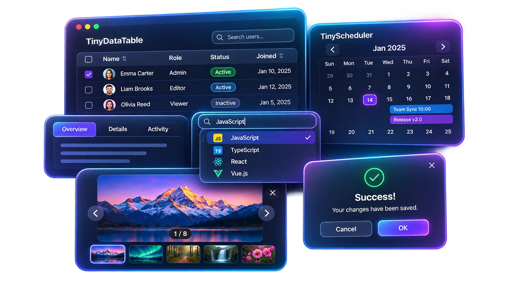

<div align="center">

<a href="https://panda-softs.github.io/TinySuite/">
  
</a>

# TinySuite

### Small components. Beautiful interfaces.

**Une collection de composants JavaScript indépendants pour construire des interfaces web modernes, interactives et personnalisables.**

<p>
  
  
  
</p>

**[Découvrir le site officiel](https://panda-softs.github.io/TinySuite/)** · **[Explorer les 20 composants](https://panda-softs.github.io/TinySuite/components/)** · **[Voir les démonstrations](https://panda-softs.github.io/TinySuite/#demos)** · **[GitHub](https://github.com/Panda-Softs/TinySuite)**

<a href="https://panda-softs.github.io/TinySuite/">
  
</a>

<sub>Un projet <a href="https://panda-softs.github.io/">Panda-Softs</a> · Des composants ciblés, utilisables individuellement.</sub>

</div>

---

## ✦ Présentation

**TinySuite** rassemble des composants d'interface et des utilitaires JavaScript conçus pour répondre à des besoins concrets : tableaux de données, calendriers, champs enrichis, navigation, galeries, dialogues, édition de contenu et rendu de templates.

L'objectif n'est **pas** de remplacer un framework ou d'imposer un design system monolithique. Chaque composant possède sa propre logique, ses fichiers, ses options et sa démonstration. On peut intégrer uniquement les outils nécessaires à une page, à une application métier ou à un tableau de bord.

### Ce qui caractérise TinySuite

| Principe | Concrètement |
| :-- | :-- |
| **Modularité** | Choisissez un composant sans importer toute la collection. |
| **Intégration directe** | La majorité des modules fonctionnent avec du JavaScript natif et des balises `<script>` / `<link>`. |
| **Comportement configurable** | Options d'initialisation, callbacks, méthodes publiques et événements selon le composant. |
| **Interfaces métier** | Recherche, sélection, validation, formulaires, actions, édition, planification et gestion de données. |
| **Styles adaptables** | CSS propre à chaque module, avec variables et options de personnalisation lorsque prévues. |
| **Démonstrations** | Une page de présentation et un accès à la démo pour chacun des 20 composants. |
| **Distribution vérifiable** | Sources et fichiers compilés contrôlés par les scripts du dépôt et GitHub Actions. |

> [!IMPORTANT]
> **Indépendant ne veut pas toujours dire « zéro dépendance ».** Les composants sont séparés et ne nécessitent pas l'installation de *toute* TinySuite. Certaines intégrations ont toutefois des dépendances explicites : **TinyGallery** utilise **TinyLightbox** ; **TinyInlineEditor** utilise **jQuery** ; d'autres modules proposent des bibliothèques ou plugins facultatifs. Les exceptions sont précisées ci-dessous.

## Navigation rapide

| Catégorie | Composants | Rôle |
| :-- | :--: | :-- |
| [Données & planification](#1--données--planification) | **2** | Tableaux avancés, calendriers, ressources |
| [Formulaires & saisie](#2--formulaires--saisie) | **6** | Suggestions, sélections, dates, couleurs, signatures |
| [Navigation & structure](#3--navigation--structure) | **5** | Onglets, menus, panneaux, sections et actions groupées |
| [Médias](#4--médias) | **3** | Galeries, visionneuses et carrousels |
| [Interactions & édition](#5--interactions--édition) | **3** | Tri manuel, édition inline, alertes et confirmations |
| [Outils développeur](#6--outils-développeur) | **1** | Templates et rendu HTML |

**[Installation](#installation-et-utilisation)** · **[Architecture](#architecture-et-philosophie-technique)** · **[Développement](#développement-et-vérifications)** · **[FAQ](#questions-fréquentes)**

---

## Catalogue des 20 composants

### 1 · Données & planification

Deux composants pour les interfaces riches en données : consultation, opérations métier, réservations et gestion des ressources.

| Composant | À quoi sert-il ? | Page |
| :-- | :-- | :-- |
| **TinyDataTable** | Afficher, rechercher, trier, filtrer et sélectionner des données tabulaires. | [Découvrir](https://panda-softs.github.io/TinySuite/TinyDataTable/) |
| **TinyScheduler** | Organiser des événements, créneaux et ressources dans plusieurs vues calendaires. | [Découvrir](https://panda-softs.github.io/TinySuite/TinyScheduler/) |

#### TinyDataTable — Tableaux de données avancés

**Pour quoi faire ?** Transformer une liste d'objets ou des données chargées depuis un serveur en tableau interactif. Particulièrement adapté aux écrans d'administration, CRM, ERP, rapports et vues opérationnelles où l'utilisateur doit retrouver et manipuler rapidement des informations.

**Fonctionnalités principales**
- Colonnes configurables : titres, visibilité, tri, recherche, classes CSS et rendu personnalisé.
- Données locales, chargement **AJAX** et modes de traitement adaptés aux volumes de données.
- Recherche globale, filtres par colonne, pagination et choix de taille de page.
- Sélection de lignes, sélection par groupe et actions contextualisées.
- Regroupements statiques ou dynamiques, lignes enfants dépliables et agrégations en pied de tableau.
- Événements (`draw`, `page`, `search`, `order`, `select`, `action`, etc.) pour synchroniser l'interface avec l'application.
- Modules complémentaires dans le dossier source : export, édition inline, sélecteurs personnalisés, multisélection, rendus et localisation française.

**Configuration et API.** Les entrées importantes sont `columns`, `data`, `ajax`, `paging`, `grouping`, `childRows` et les options de recherche/sélection. L'API permet notamment `search()`, `sortBy()`, `goToPage()`, `setData()`, `getSelectedRows()` et `on()` / `off()`.

```js
const table = new TinyDataTable('#users', {
  columns: [
    { key: 'name', title: 'Nom', sortable: true },
    { key: 'role', title: 'Rôle', sortable: true }
  ],
  data: [
    { name: 'Alice', role: 'Admin' },
    { name: 'Bob', role: 'Éditeur' }
  ],
  paging: { enabled: true, pageSize: 10 }
});
```

**Points forts.** Grande richesse fonctionnelle sans dépendre de jQuery pour le cœur du tableau ; rendu personnalisable ; séparation entre données, affichage et pagination. **À savoir :** la mise en évidence des recherches peut utiliser `mark.js` ; certaines fonctions d'export/démonstration utilisent des bibliothèques tierces. Vérifiez les modules chargés et validez côté serveur toute action sur les données.

**[Page du composant](https://panda-softs.github.io/TinySuite/TinyDataTable/)** · [Démo](https://panda-softs.github.io/TinySuite/TinyDataTable/demo/) · [Sources](./TinyDataTable/) · [Documentation détaillée](./TinyDataTable/README.md)

#### TinyScheduler — Calendrier et planification de ressources

**Pour quoi faire ?** Construire des agendas, des outils de réservation, des plannings d'équipes ou des écrans de disponibilité de ressources : salles, véhicules, collaborateurs, équipements, etc.

**Fonctionnalités principales**
- Vues `month`, `week`, `day`, `list`, `resourceTimeGrid` et `resourceTimeline`.
- Planification par ressource, avec périodes jour/semaine et, en timeline, mois.
- Événements locaux ou issus de sources externes ; navigation entre dates et vues.
- Sélection de créneaux, déplacement par glisser-déposer et redimensionnement lorsque activés.
- Détection des chevauchements avec `eventConflictScope` et callbacks d'arbitrage.
- Rafraîchissement ciblé des événements et préservation du défilement dans plusieurs vues.
- Hooks de cycle de vie et callbacks pour ajout, édition, déplacement, suppression et chargement.

**Configuration et API.** Les options clés sont `initialView`, `initialDate`, `events`, `eventSources`, `resources`, `resourceSources`, `editable`, `selectable`, `planningRange`, `slotDuration`, `minTime`, `maxTime` et `onEventConflict`. Un callback peut retourner `false` ou `Promise<false>` pour annuler une opération concernée.

```js
const scheduler = new TinyScheduler('#calendar', {
  initialView: 'resourceTimeline',
  planningRange: 'week',
  editable: true,
  resources: [{ id: 'room-1', title: 'Salle 1' }],
  events: [{
    id: 'meeting-1', title: 'Réunion',
    start: '2026-11-09T10:00:00',
    end: '2026-11-09T11:00:00',
    resourceId: 'room-1'
  }]
});
scheduler.render();
```

**Points forts.** Plusieurs modèles de calendrier dans un seul composant, callbacks annulables et architecture de rafraîchissement conçue pour limiter les reconstructions du DOM. **Configuration spéciale :** les fichiers de distribution s'appellent **`tiny-scheduler.min.js`** et **`tiny-scheduler.min.css`** (minuscules), contrairement à la convention de nombreux autres modules. Les conflits doivent aussi être validés par le serveur pour éviter les doubles réservations concurrentes.

**[Page du composant](https://panda-softs.github.io/TinySuite/TinyScheduler/)** · [Démo](https://panda-softs.github.io/TinySuite/TinyScheduler/demo/) · [Sources](./TinyScheduler/) · [Documentation détaillée](./TinyScheduler/README.md)

---

### 2 · Formulaires & saisie

Six composants pour rendre les formulaires plus rapides, plus précis et plus agréables à utiliser.

| Composant | À quoi sert-il ? | Page |
| :-- | :-- | :-- |
| **TinyAutocomplete** | Suggérer des valeurs dans un champ texte. | [Découvrir](https://panda-softs.github.io/TinySuite/TinyAutocomplete/) |
| **TinySelectize** | Enrichir un `<select>` simple ou multiple. | [Découvrir](https://panda-softs.github.io/TinySuite/TinySelectize/) |
| **TinyChips** | Saisir et gérer des étiquettes ou valeurs multiples. | [Découvrir](https://panda-softs.github.io/TinySuite/TinyChips/) |
| **TinyDatePicker** | Choisir une date ou une période. | [Découvrir](https://panda-softs.github.io/TinySuite/TinyDatePicker/) |
| **tinyColorPicker** | Sélectionner une couleur depuis une palette ou un sélecteur natif. | [Découvrir](https://panda-softs.github.io/TinySuite/tinyColorPicker/) |
| **TinySignature** | Capturer une signature manuscrite dans un canvas. | [Découvrir](https://panda-softs.github.io/TinySuite/TinySignature/) |

#### TinyAutocomplete — Suggestions intelligentes

**Pour quoi faire ?** Compléter un champ texte au fil de la frappe : villes, clients, références, adresses, catégories ou recherches métier. Contrairement à un sélecteur enrichi, l'utilisateur travaille toujours dans son `<input>` natif.

**Fonctionnalités principales.** Suggestions locales ou distantes via `fetch`, tri par pertinence, mise en évidence des correspondances, rendu personnalisé des résultats, navigation clavier (`↑`, `↓`, `Enter`, `Escape`, `Tab`), temporisation des recherches et annulation des requêtes devenues obsolètes avec `AbortController`.

**Configuration et API.** `data`, `url`, `queryParam`, `minLength`, `limit`, `searchDelay`, ainsi que les fonctions de rendu/tri. Initialisation avec `TinyAutocomplete.init(selector, options)` ; récupération via `TinyAutocomplete.getInstance()` ; méthodes d'instance `search()`, `open()`, `close()`, `clear()`, `enable()`, `disable()` et `destroy()`.

**Points forts.** Intégration simple à un formulaire existant, pas de jQuery et gestion explicite des requêtes asynchrones. **À savoir :** une recherche distante exige un endpoint applicatif et une validation serveur des valeurs retenues.

**[Page du composant](https://panda-softs.github.io/TinySuite/TinyAutocomplete/)** · [Démo](https://panda-softs.github.io/TinySuite/TinyAutocomplete/demo/) · [Sources](./TinyAutocomplete/) · [Documentation détaillée](./TinyAutocomplete/README.md)

#### TinySelectize — Sélecteur enrichi, simple ou multiple

**Pour quoi faire ?** Améliorer un `<select>` HTML avec recherche, sélection multiple, chargement distant et présentation personnalisée, sans perdre le fonctionnement du formulaire natif.

**Fonctionnalités principales.** Sélection simple/multiple, filtrage clavier, options locales ou AJAX, loaders asynchrones (Promise ou callback), cache des recherches, optgroups, templates de rendu, dropdown détaché pour éviter les problèmes de superposition, plugins de type arbre et marquage, restauration éventuelle des valeurs via `localStorage`.

**Configuration et API.** `minChars`, `options`, `valueField`, `labelField`, `searchField`, `load`, `ajax.url`, `ajax.queryParam`, `render.option`, `render.item`, `dropdownParent`, `storageKey`, `maxOptions`. Méthodes `val()`, `addOption()`, `addItem()`, `refreshOptions()`, `sync()`, `open()`, `close()`, `destroy()` et `whenValueReady()`.

```js
const select = new TinySelectize('#country', {
  minChars: 0,
  searchField: ['label'],
  showSelectedInDropdown: false
});
```

**Points forts.** Le `<select>` d'origine reste la **source de vérité**, conserve ses valeurs de formulaire et émet `change`. **Configuration spéciale :** plugins `TinySelectize.Tree.plugin.js` et `TinySelectize.Mark.plugin.js` à charger uniquement si nécessaires ; les résultats AJAX doivent respecter le contrat du loader ou être transformés avec les options prévues.

**[Page du composant](https://panda-softs.github.io/TinySuite/TinySelectize/)** · [Démo](https://panda-softs.github.io/TinySuite/TinySelectize/demo/) · [Sources](./TinySelectize/) · [Documentation détaillée](./TinySelectize/README.md)

#### TinyChips — Tags, étiquettes et saisie structurée

**Pour quoi faire ?** Permettre l'ajout et la suppression de plusieurs valeurs dans un même contrôle : mots-clés, compétences, destinataires, catégories, filtres ou étiquettes d'un objet métier.

**Fonctionnalités principales.** Affichage en « chips », ajout/suppression/sélection, suggestions statiques ou AJAX, validation par motif, contrôle des doublons et du nombre maximal, personnalisation des champs de valeur/libellé, callbacks d'ajout, suppression, changement et refus.

**Configuration et API.** Deux modes : **conteneur** (`<div>`) ou **champ source** (`<input>`). Dans le second, l'input natif est conservé et synchronisé automatiquement. `valueMode: 'json'` gère les étiquettes contenant des virgules ; `valueMode: 'csv'` convient aux valeurs simples. Options utiles : `limit`, `allowDuplicates`, `separators`, `pattern`, `autocompleteOptions.url`, `autocompleteOptions.loadOnce`, `valueField`, `labelField`, `onChange`.

**Points forts.** Bonne intégration aux formulaires et gestion explicite de la sérialisation. **À savoir :** privilégier JSON lorsque les valeurs peuvent contenir des séparateurs ; les règles de validation côté client ne remplacent pas celles du backend.

**[Page du composant](https://panda-softs.github.io/TinySuite/TinyChips/)** · [Démo](https://panda-softs.github.io/TinySuite/TinyChips/demo/) · [Sources](./TinyChips/) · [Documentation détaillée](./TinyChips/README.md)

#### TinyDatePicker — Dates et plages de dates

**Pour quoi faire ?** Remplacer ou compléter un champ date avec un calendrier adapté aux formulaires : réservations, échéances, périodes de reporting, dates de début et de fin.

**Fonctionnalités principales.** Modes `inline`, `modal` et `permanent` ; sélection d'une date ou d'un intervalle ; localisation des mois/jours et des libellés ; formats de sortie ; contraintes min/max ; interdiction des week-ends ou de dates définies par une fonction ; navigation par mois et année ; boutons de validation et d'effacement.

**Configuration et API.** `mode`, `allowRangeSelection`, `selectedRange`, `rangeSeparator`, `dateFormat`, `locale`, `i18n`, `minDate`, `maxDate`, `dateRule`, `disableWeekends`, `disableDayFn`, `firstDay`, `showClearBtn`, `inputTriggerMode` et `autoClose`. Initialisation avec `new TinyDatePicker(target, options)` ; méthodes de lecture/écriture des dates et des intervalles documentées dans le module.

```js
const picker = new TinyDatePicker('#booking-date', {
  mode: 'modal',
  allowRangeSelection: true,
  showClearBtn: true,
  disableWeekends: true
});
```

**Points forts.** Même composant pour plusieurs présentations et règles métier, avec options de localisation. **À savoir :** préciser le format de date attendu par le serveur et gérer séparément les fuseaux horaires si l'application travaille avec des instants datés.

**[Page du composant](https://panda-softs.github.io/TinySuite/TinyDatePicker/)** · [Démo](https://panda-softs.github.io/TinySuite/TinyDatePicker/demo/) · [Sources](./TinyDatePicker/) · [Documentation détaillée](./TinyDatePicker/README.md)

#### tinyColorPicker — Palettes et couleurs personnalisées

**Pour quoi faire ?** Choisir une couleur dans une interface de personnalisation : thème, catégorie, statut, événement, étiquette ou élément graphique.

**Fonctionnalités principales.** Palette configurable, couleurs récentes, saisie HEX, sélecteur de couleur natif facultatif, effacement facultatif, ouverture automatique vers le haut/bas, conteneur parent configurable et événement `tinycolorpicker:change`.

**Configuration et API.** `palette`, `allowRecent`, `recentMax`, `allowCustomColor`, `allowClearColor`, `initialColor`, `direction`, `parentContainer`, `storageKey`, `onColorSelected`. Méthodes `getValue()`, `setValue()`, `clear()`, `show()`, `hide()`, `toggle()` et `destroy()`.

**Points forts.** Faible surface d'intégration et utilisation du sélecteur natif pour les couleurs libres. **Configuration spéciale :** le mode clair/sombre suit **`color-scheme` et `light-dark()` en CSS** ; il n'existe pas d'option JavaScript `theme` ni de méthode `setTheme()`. Des variables CSS comme `--tcp-color` et `--tcp-color-soft` exposent la couleur choisie.

**[Page du composant](https://panda-softs.github.io/TinySuite/tinyColorPicker/)** · [Démo](https://panda-softs.github.io/TinySuite/tinyColorPicker/demo/) · [Sources](./tinyColorPicker/) · [Documentation détaillée](./tinyColorPicker/README.md)

#### TinySignature — Signature manuscrite sur canvas

**Pour quoi faire ?** Capturer un tracé manuscrit dans le navigateur, par exemple pour une validation interne, un bon de réception, une fiche d'intervention ou un formulaire.

**Fonctionnalités principales.** Tracé à la souris, au doigt ou au stylet ; largeur du trait adaptée au mouvement ; couleur du stylo et fond configurables ; historique annuler/rétablir ; redimensionnement du canvas ; détection de signature vide ; import/export des points et export image PNG, JPEG ou SVG.

**Configuration et API.** `penColor`, `backgroundColor`, `minWidth`, `maxWidth`, `minDistance`, `velocityFilterWeight`, `throttle`. Méthodes `clear()`, `undo()`, `redo()`, `isEmpty()`, `resizeCanvas()`, `toDataURL()`, `fromDataURL()` et fonctions de manipulation des points.

**Points forts.** Un composant autonome basé sur Canvas 2D, sans service externe imposé. **À savoir :** utiliser un fond opaque pour exporter en JPEG ; adapter la taille du canvas à sa densité de pixels ; une image de signature **n'est pas à elle seule** une solution de signature électronique juridiquement qualifiée.

**[Page du composant](https://panda-softs.github.io/TinySuite/TinySignature/)** · [Démo](https://panda-softs.github.io/TinySuite/TinySignature/demo/) · [Sources](./TinySignature/) · [Documentation détaillée](./TinySignature/README.md)

---

### 3 · Navigation & structure

Cinq composants pour organiser l'espace, les menus et les parcours utilisateur.

| Composant | À quoi sert-il ? | Page |
| :-- | :-- | :-- |
| **TinyTabs** | Répartir un contenu en panneaux à onglets. | [Découvrir](https://panda-softs.github.io/TinySuite/TinyTabs/) |
| **TinyDropdown** | Afficher des menus d'actions contextuelles. | [Découvrir](https://panda-softs.github.io/TinySuite/TinyDropdown/) |
| **TinySideNav** | Construire une navigation latérale. | [Découvrir](https://panda-softs.github.io/TinySuite/TinySideNav/) |
| **TinyCollapsible** | Déplier/replier des sections ou menus accordéon. | [Découvrir](https://panda-softs.github.io/TinySuite/TinyCollapsible/) |
| **TinyGroupButton** | Présenter des cases à cocher sous forme de boutons groupés. | [Découvrir](https://panda-softs.github.io/TinySuite/TinyGroupButton/) |

#### TinyTabs — Onglets accessibles et adaptables

**Pour quoi faire ?** Organiser plusieurs sections dans une même page : profil, paramètres, historique, détails, statistiques ou sous-écrans d'une application.

**Fonctionnalités principales.** Panneaux d'onglets, indicateur actif, onglets désactivés, navigation au clavier, attributs ARIA de base, mode tactile « swipeable », durée d'animation configurable et callbacks lors du changement de panneau.

**Configuration et API.** `element`, `duration`, `swipeable`, `onShow` ; `select(tabId)`, `updateTabIndicator()`, `destroy()`, `TinyTabs.init()` et `TinyTabs.getInstance()`.

**Points forts.** API compacte, sans jQuery ni moteur d'animation externe ; bonne adéquation aux pages de paramètres et fiches complexes. **À savoir :** associer correctement chaque onglet à son panneau et vérifier l'accessibilité dans le contexte réel de l'application.

**[Page du composant](https://panda-softs.github.io/TinySuite/TinyTabs/)** · [Démo](https://panda-softs.github.io/TinySuite/TinyTabs/demo/) · [Sources](./TinyTabs/) · [Documentation détaillée](./TinyTabs/README.md)

#### TinyDropdown — Menus d'actions et menus contextuels

**Pour quoi faire ?** Afficher une liste d'actions près d'un bouton : « Voir », « Modifier », « Dupliquer », « Supprimer », ou choisir une option dans une barre d'outils.

**Fonctionnalités principales.** Ouverture au clic ou au survol, alignement gauche/droite, largeur liée au déclencheur, fermeture automatique, positionnement adapté à l'espace disponible, animation CSS, callbacks de cycle de vie et gestion de menus partagés entre plusieurs lignes.

**Configuration et API.** `alignment`, `constrainWidth`, `coverTrigger`, `closeOnClick`, `hover`, `container`, `virtualTrigger`, `adjustMenuState`, `onBeforeOpen`, `onItemClick`. En mode `virtualTrigger`, le même menu peut être ouvert depuis différents boutons via `openFrom(trigger)`.

**Points forts.** Particulièrement pratique dans les tableaux et interfaces à nombreux boutons d'action. **À savoir :** le menu peut être trouvé via `data-target`, `aria-controls` ou un élément voisin ; les droits d'exécuter une action doivent toujours être vérifiés côté serveur.

**[Page du composant](https://panda-softs.github.io/TinySuite/TinyDropdown/)** · [Démo](https://panda-softs.github.io/TinySuite/TinyDropdown/demo/) · [Sources](./TinyDropdown/) · [Documentation détaillée](./TinyDropdown/README.md)

#### TinySideNav — Navigation latérale et menus mobiles

**Pour quoi faire ?** Proposer un panneau de navigation latéral pour un dashboard, une application de gestion ou une interface mobile.

**Fonctionnalités principales.** Ouverture depuis la gauche ou la droite, fond de recouvrement, gestes tactiles de glissement, verrouillage du défilement de la page, fermeture explicite et callbacks d'ouverture/fermeture.

**Configuration et API.** `edge: 'left' | 'right'`, `draggable`, `preventScrolling`, `inDuration`, `outDuration`, `onOpenStart`, `onOpenEnd`, `onCloseStart`, `onCloseEnd`. API `new TinySideNav(...)`, `TinySideNav.init(...)` et `TinySideNav.getInstance(...)`.

**Points forts.** Pas de dépendance à jQuery ou à un moteur d'animation ; intégration naturelle à une navigation responsive. **À savoir :** tester le focus, le verrouillage du scroll et la fermeture dans les pages qui comportent d'autres overlays.

**[Page du composant](https://panda-softs.github.io/TinySuite/TinySideNav/)** · [Démo](https://panda-softs.github.io/TinySuite/TinySideNav/demo/) · [Sources](./TinySideNav/) · [Documentation détaillée](./TinySideNav/README.md)

#### TinyCollapsible — Accordéons et sections repliables

**Pour quoi faire ?** Réduire la densité d'une page en regroupant les informations par sections : FAQ, filtres, paramètres, catégories, menus de navigation ou fiches détaillées.

**Fonctionnalités principales.** Mode accordéon (une seule section ouverte) ou multi-ouverture, animations configurables, éléments désactivés, callbacks annulables avant ouverture/fermeture, ouverture/fermeture programmatiques et contrôleur supplémentaire `TinyCollapsibleMenu` pour les menus imbriqués.

**Configuration et API.** `accordion`, `inDuration`, `outDuration`, `easing`, `headerSelector`, `bodySelector`, `activeClass`, `onOpenStart`, `onCloseStart`. Méthodes `open()`, `close()`, `toggle()`, `openAll()`, `closeAll()` et fonctions de gestion des sections.

**Points forts.** Compatible avec une structure HTML simple et configurable sans bibliothèque d'animation. **À savoir :** les callbacks `onOpenStart` et `onCloseStart` peuvent retourner `false` pour bloquer une transition.

**[Page du composant](https://panda-softs.github.io/TinySuite/TinyCollapsible/)** · [Démo](https://panda-softs.github.io/TinySuite/TinyCollapsible/demo/) · [Sources](./TinyCollapsible/) · [Documentation détaillée](./TinyCollapsible/README.md)

#### TinyGroupButton — Groupes de choix visuels

**Pour quoi faire ?** Transformer plusieurs cases à cocher en un groupe de boutons de sélection : catégories de produits, filtres, disciplines, préférences ou attributs d'un formulaire.

**Fonctionnalités principales.** Cases à cocher natives comme source de vérité, sélection multiple, option spéciale « Tous », synchronisation de l'état visuel, valeur CSV normalisée, événements natifs `onChange` et `afterChange`, prise en charge d'options ajoutées dynamiquement.

**Configuration et API.** `TinyGroupButton.getInstance('#categories', options)` crée ou retrouve l'instance ; `buildValue()`, `getValue()`, `updateValue()`, `setValue()`, `check()` et `destroy()`. L'option `activeClass` personnalise l'apparence des éléments sélectionnés.

**Points forts.** Léger et proche du fonctionnement natif des formulaires. **Configuration spéciale :** la case « Tous » porte la classe `.all` sur l'`input` ; elle ne figure pas dans la valeur CSV. `updateValue()` synchronise le DOM sans déclencher `onChange`.

**[Page du composant](https://panda-softs.github.io/TinySuite/TinyGroupButton/)** · [Démo](https://panda-softs.github.io/TinySuite/TinyGroupButton/demo/) · [Sources](./TinyGroupButton/) · [Documentation détaillée](./TinyGroupButton/README.md)

---

### 4 · Médias

Trois outils complémentaires pour présenter, parcourir et organiser des images ou d'autres contenus visuels.

| Composant | À quoi sert-il ? | Page |
| :-- | :-- | :-- |
| **TinyGallery** | Gérer une collection d'images avec ajout, retrait et réorganisation. | [Découvrir](https://panda-softs.github.io/TinySuite/TinyGallery/) |
| **TinyLightbox** | Ouvrir des images en grand avec zoom et navigation. | [Découvrir](https://panda-softs.github.io/TinySuite/TinyLightbox/) |
| **TinyCarousel** | Faire défiler des cartes, images ou contenus en slides. | [Découvrir](https://panda-softs.github.io/TinySuite/TinyCarousel/) |

#### TinyGallery — Galerie éditable et gestion d'images

**Pour quoi faire ?** Administrer les photos d'un produit, d'un bien, d'une annonce ou d'une fiche métier. Le composant est conçu autant pour la **consultation** que pour la **préparation des modifications** avant enregistrement.

**Fonctionnalités principales.** Miniatures, ajout de fichiers, suppression avec annulation, changement d'ordre, état des images existantes/ajoutées/modifiées, ouverture dans TinyLightbox, hooks d'édition d'image, limites de nombre et de taille, callbacks de changement et d'erreur.

**Configuration et API.** `images`, `resolveUrl`, `maxImages`, `maxFileSize`, `sortable`, `addable`, `removable`, `editable`, `onEdit`, `confirmRemove`, `onChange`. Méthodes `setImages()`, `addFiles()`, `getItems()`, `getState()`, `getValue()`, `move()`, `remove()`, `undo()` et `destroy()`.

**Points forts.** Modèle d'état utile pour différencier les fichiers déjà enregistrés des modifications en attente. **Dépendance requise :** charger **TinyLightbox** avant **TinyGallery**. **À savoir :** la galerie ne remplace pas un backend d'upload : l'application doit enregistrer les nouveaux fichiers, gérer les suppressions et contrôler les autorisations. L'éditeur/cropper est fourni par un callback externe.

**[Page du composant](https://panda-softs.github.io/TinySuite/TinyGallery/)** · [Démo](https://panda-softs.github.io/TinySuite/TinyGallery/demo/) · [Sources](./TinyGallery/) · [Documentation détaillée](./TinyGallery/README.md)

#### TinyLightbox — Visionneuse d'images immersive

**Pour quoi faire ?** Afficher des photos dans une fenêtre plein écran avec navigation fluide, sans quitter la page : galeries produits, portfolios, collections et pièces jointes visuelles.

**Fonctionnalités principales.** Ouverture depuis des liens `data-lightbox` ou depuis un tableau d'images, précédent/suivant, zoom et déplacement, molette, double-clic, gestes tactiles, fermeture verticale, raccourcis clavier, préchargement des images voisines, légendes et animations personnalisables.

**Configuration et API.** `images`, `selector`, `loop`, `maxZoom`, `zoomStep`, `wheelZoom`, `swipe`, `verticalClose`, `effects`, `captions`, `captionPosition`, `keyboard`, `preload` et callbacks (`onOpen`, `onClose`, `onChange`, etc.). Méthodes `open()`, `close()`, `next()`, `previous()`, `goTo()`, `zoomIn()`, `zoomOut()` et `destroy()`.

**Points forts.** Utilisable seule ou comme visionneuse de TinyGallery, sans framework. **À savoir :** le composant documenté est une **visionneuse d'images** ; ne pas supposer une prise en charge native de la vidéo. Les légendes et URLs fournies par l'application doivent rester fiables et contrôlées.

**[Page du composant](https://panda-softs.github.io/TinySuite/TinyLightbox/)** · [Démo](https://panda-softs.github.io/TinySuite/TinyLightbox/demo/) · [Sources](./TinyLightbox/) · [Documentation détaillée](./TinyLightbox/README.md)

#### TinyCarousel — Carrousel 3D et défilement de contenus

**Pour quoi faire ?** Mettre en avant des images, des cartes produits, des témoignages ou des sections éditoriales dans un espace horizontal interactif.

**Fonctionnalités principales.** Mode carrousel 3D de type Materialize, mode `fullWidth` en piste horizontale, plusieurs slides visibles, navigation par flèches, indicateurs positionnables, barre de progression, réglage du déplacement par action et option de non-bouclage.

**Configuration et API.** `fullWidth`, `perPage`, `perMove`, `gap`, `padding`, `arrows`, `indicators`, `indicatorsPosition`, `progressBar`, `noWrap`, `duration`, `numVisible`, `onCycleTo`.

```js
const carousel = new TinyCarousel(document.querySelector('#carousel'), {
  fullWidth: true,
  perPage: 3,
  perMove: 1,
  gap: '1rem',
  arrows: true,
  indicators: true
});
```

**Points forts.** Un composant pour deux présentations distinctes, avec navigation et densité de slides configurables. **À savoir :** `progressBar` remplace les indicateurs classiques ; adaptez `perPage` aux tailles d'écran et fournissez des textes alternatifs aux images.

**[Page du composant](https://panda-softs.github.io/TinySuite/TinyCarousel/)** · [Démo](https://panda-softs.github.io/TinySuite/TinyCarousel/demo/) · [Sources](./TinyCarousel/) · [Documentation détaillée](./TinyCarousel/README.md)

---

### 5 · Interactions & édition

Trois composants pour agir directement sur les données et guider les décisions de l'utilisateur.

| Composant | À quoi sert-il ? | Page |
| :-- | :-- | :-- |
| **TinySortableList** | Réordonner des éléments par glisser-déposer ou clavier. | [Découvrir](https://panda-softs.github.io/TinySuite/TinySortableList/) |
| **TinyInlineEditor** | Modifier du texte riche directement dans une page. | [Découvrir](https://panda-softs.github.io/TinySuite/TinyInlineEditor/) |
| **TinySwal** | Afficher dialogues, confirmations, formulaires et notifications. | [Découvrir](https://panda-softs.github.io/TinySuite/TinySwal/) |

#### TinySortableList — Réorganisation de listes

**Pour quoi faire ?** Laisser l'utilisateur définir l'ordre d'éléments métier : ressources, étapes, priorités, catégories, images ou lignes de configuration.

**Fonctionnalités principales.** Glisser-déposer à la souris, au toucher ou au stylet, déplacement au clavier (`ArrowUp` / `ArrowDown`), calcul des éléments dont l'ordre a réellement changé, prise en charge des éléments ajoutés dynamiquement, callbacks de début/changement/fin et restauration de l'ordre en cas d'échec.

**Configuration et API.** `getId`, `onStart`, `onChange`, `onEnd`, `onError`. Méthodes `getItems()`, `getOrder()`, `getChanges()`, `setOrder()` et `destroy()`.

**Points forts.** Contrat particulièrement utile pour la persistance : `onEnd()` peut attendre une requête asynchrone ; retourner `false` restaure l'ordre précédent. **À savoir :** enregistrer les positions côté serveur avec validation des identifiants et des permissions.

**[Page du composant](https://panda-softs.github.io/TinySuite/TinySortableList/)** · [Démo](https://panda-softs.github.io/TinySuite/TinySortableList/demo/) · [Sources](./TinySortableList/) · [Documentation détaillée](./TinySortableList/README.md)

#### TinyInlineEditor — Édition de contenu dans la page

**Pour quoi faire ?** Modifier une description, une note, un commentaire ou un contenu HTML directement là où il est affiché, sans ouvrir un formulaire séparé.

**Fonctionnalités principales.** Barre contextuelle de mise en forme (gras, italique, titres, listes, liens, alignement, couleurs), thèmes `light`, `dark` et `purple` expérimental, intégration `DIV`/`SPAN`/`TEXTAREA`, événements de modification, sauvegarde différée, sauvegarde explicite et gestion d'instances multiples.

**Configuration et API.** Plugin `$('#editor').tinyInlineEditor({...})` ; compatibilité avec `$.fn.inLine`. Options `toolbar`, `formats`, `colors`, `theme`, `autosaveOn`, `pasteAsPlainText`, `sanitizeHTML`, `onChange`, `onSave`. Méthodes d'instance `setContent()`, `commitChange()`, `flush()` et `destroy()`.

**Points forts.** Édition rapide, callbacks métier et sauvegardes sérialisées par instance. **Dépendance requise : jQuery.** **Attention sécurité :** l'éditeur **ne nettoie pas automatiquement le HTML non fiable**. Assainir les contenus avant insertion et côté serveur ; `document.execCommand`, utilisé par cette implémentation, est une API dépréciée. Attendre `flush()` avant destruction lorsqu'une sauvegarde doit être garantie.

**[Page du composant](https://panda-softs.github.io/TinySuite/TinyInlineEditor/)** · [Démo](https://panda-softs.github.io/TinySuite/TinyInlineEditor/demo/) · [Sources](./TinyInlineEditor/) · [Documentation détaillée](./TinyInlineEditor/README.md)

#### TinySwal — Dialogues, alertes et notifications

**Pour quoi faire ?** Remplacer les alertes natives par des dialogues de confirmation, de validation, de suppression ou de saisie, et afficher des notifications discrètes (« toasts »).

**Fonctionnalités principales.** Fenêtres modales, toasts empilables, boutons confirmer/refuser/supprimer/annuler, formulaires, valeurs structurées, promesses de résultat, validation asynchrone, timers et barres de progression, dialogues déplaçables, contenus défilants, cibles de montage et personnalisation via variables CSS.

**Configuration et API.** `TinySwal.fire({...})` retourne une **Promise** ; les résultats indiquent notamment `isConfirmed`, `isDenied` ou `isDeleted`. Options pour titres, icônes, boutons, durée, positionnement, validations et callbacks. Des helpers statiques facilitent l'affichage de dialogues et notifications.

```js
const result = await TinySwal.fire({
  title: 'Supprimer cet élément ?',
  text: 'Cette action nécessite une confirmation.',
  icon: 'warning',
  showCancelButton: true
});

if (result.isConfirmed) {
  // Effectuer l'action autorisée par le serveur.
}
```

**Points forts.** API asynchrone claire, plusieurs types de réponses et grande flexibilité d'affichage. **À savoir :** les boutons et validations client améliorent l'expérience, mais ne remplacent jamais une autorisation backend ; vérifier les cas de fermeture, d'annulation et d'échec réseau.

**[Page du composant](https://panda-softs.github.io/TinySuite/TinySwal/)** · [Démo](https://panda-softs.github.io/TinySuite/TinySwal/demo/) · [Sources](./TinySwal/) · [Documentation détaillée](./TinySwal/README.md)

---

### 6 · Outils développeur

Un utilitaire orienté composition d'interfaces et rendu de contenu dynamique.

| Composant | À quoi sert-il ? | Page |
| :-- | :-- | :-- |
| **TinyT** | Compiler et afficher des templates HTML à partir de données JavaScript. | [Découvrir](https://panda-softs.github.io/TinySuite/TinyT/) |

#### TinyT — Moteur de templates JavaScript

**Pour quoi faire ?** Générer du HTML à partir de données applicatives sans installer un framework complet : lignes de tableau, cartes, panneaux, fragments réutilisables ou vues de détail.

**Fonctionnalités principales.** Interpolation d'expressions JavaScript, conditions `{{if}}` / `{{else}}`, boucles `{{each}}`, templates imbriqués `{{tmpl}}`, fonctions utilitaires, enregistrement de templates, compilation et cache, rendu vers une chaîne ou un élément DOM, traitement de tableaux et diagnostic des identifiants manquants.

**Configuration et API.** `TinyT.render(template, data)`, `TinyT.renderTo(element, template, data)`, `TinyT.compile()`, `TinyT.registerTemplate()`, `TinyT.clearCache()` et `TinyT.configure()`. Options `helpers`, `strict`, `missingToUndefined`, `onMissing` et `rowTransform`. Une intégration jQuery est disponible **facultativement** via `$.tmpl()` / `$.fn.tmplTo()`.

```js
const html = TinyT.render('<strong>${name}</strong>', {
  name: 'TinySuite'
});
```

**Points forts.** Moteur ciblé, templates réutilisables et cache de compilation. **Attention sécurité :** TinyT évalue des expressions JavaScript et **n'échappe pas automatiquement toutes les interpolations HTML**. N'utiliser que des templates de confiance ; échapper ou assainir les données avant insertion dans le DOM. Ce n'est pas un moteur de templates sandboxé.

**[Page du composant](https://panda-softs.github.io/TinySuite/TinyT/)** · [Démo](https://panda-softs.github.io/TinySuite/TinyT/demo/) · [Sources](./TinyT/) · [Documentation détaillée](./TinyT/README.md)

---

## Installation et utilisation

### Option A — Intégrer un seul composant

La méthode la plus directe consiste à copier les fichiers nécessaires depuis le dossier du composant, puis à charger son CSS (lorsqu'il existe) et son JavaScript.

Exemple avec **TinyTabs**, en conservant l'arborescence TinySuite sur le serveur :

```html
<link rel="stylesheet" href="/assets/TinySuite/TinyTabs/dist/TinyTabs.min.css">

<ul class="tabs js-tabs">
  <li class="tab"><a href="#overview" class="active">Aperçu</a></li>
  <li class="tab"><a href="#settings">Paramètres</a></li>
</ul>
<section id="overview">Contenu de l'aperçu</section>
<section id="settings">Contenu des paramètres</section>

<script src="/assets/TinySuite/TinyTabs/dist/TinyTabs.min.js"></script>
<script>
  const tabs = new TinyTabs({ element: '.js-tabs' });
</script>
```

> Les chemins `/assets/TinySuite/...` sont **illustratifs** : adaptez-les à votre hébergement. Les fichiers compilés sont dans `dist/` lorsqu'ils sont produits par le build du dépôt. Pour les scripts ou styles additionnels, consultez le README du module.

### Option B — Utiliser plusieurs composants

Chargez uniquement les modules utilisés par la page, dans le bon ordre lorsqu'une dépendance existe. Exemple : **TinyLightbox + TinyGallery**.

```html
<link rel="stylesheet" href="/assets/TinySuite/TinyLightbox/dist/TinyLightbox.min.css">
<link rel="stylesheet" href="/assets/TinySuite/TinyGallery/dist/TinyGallery.min.css">

<div id="gallery"></div>

<script src="/assets/TinySuite/TinyLightbox/dist/TinyLightbox.min.js"></script>
<script src="/assets/TinySuite/TinyGallery/dist/TinyGallery.min.js"></script>
<script>
  const gallery = new TinyGallery('#gallery', {
    images: ['photo-1.webp', 'photo-2.webp'],
    resolveUrl: name => '/images/' + encodeURIComponent(name)
  });
</script>
```

### Cas particuliers de distribution

| Composant | Particularité |
| :-- | :-- |
| **TinyScheduler** | Fichiers compilés `dist/tiny-scheduler.min.js` et `dist/tiny-scheduler.min.css` ; sources réparties entre plusieurs fichiers JS/SCSS. |
| **TinyDataTable** | Modules JS complémentaires (export, rendu, sélection, édition, localisation) ; charger ceux dont l'intégration a besoin. |
| **TinySelectize** | Plugins d'arbre et de marquage séparés. |
| **TinyGallery** | Nécessite TinyLightbox, chargé avant elle. |
| **TinyInlineEditor** | Nécessite jQuery ; un fichier vendor est fourni dans le dossier du composant. |
| **TinyGroupButton / TinySignature / TinyT** | La liste de build principale génère leur JavaScript minifié, sans CSS de distribution propre à ces trois modules. |
| **tinyColorPicker** | Nom du dossier sensible à la casse : `tinyColorPicker`, classe JavaScript `TinyColorPicker`. |

### Quel composant choisir ?

| Besoin | Composant recommandé |
| :-- | :-- |
| Compléter un `<input>` texte | **TinyAutocomplete** |
| Enrichir un `<select>` et conserver son comportement natif | **TinySelectize** |
| Saisir plusieurs tags libres | **TinyChips** |
| Présenter des résultats métier avec tri, filtres et pagination | **TinyDataTable** |
| Réserver un créneau ou planifier des ressources | **TinyScheduler** |
| Parcourir des photos en plein écran | **TinyLightbox** |
| Ajouter, retirer et ordonner des photos | **TinyGallery** + **TinyLightbox** |
| Présenter des cartes ou images en slides | **TinyCarousel** |
| Demander confirmation avant une action | **TinySwal** |
| Éditer directement du HTML dans une page | **TinyInlineEditor** |
| Réordonner une liste métier | **TinySortableList** |

---

## Architecture et philosophie technique

### Un dépôt commun, des composants séparés

La bibliothèque est organisée autour de dossiers individuels à la racine du dépôt. Chaque dossier peut contenir sa source JavaScript, son style CSS/SCSS, ses distributions, sa documentation, ses démonstrations et parfois ses tests ou plugins.

```text
TinySuite/
├── TinyDataTable/
│   ├── TinyDataTable.js
│   ├── README.md
│   ├── demo/
│   └── dist/
├── TinyScheduler/
│   ├── src/js/
│   ├── src/scss/
│   ├── README.md
│   ├── demo/
│   └── dist/
├── TinyAutocomplete/
├── TinySelectize/
├── ... autres composants ...
├── scripts/
│   ├── dist-entries.json
│   ├── build-dist.cjs
│   ├── build-site.py
│   ├── build_site.py
│   ├── verify_site.py
│   └── check-demos.cjs
├── website/
│   ├── catalog.json
│   ├── src/scss/
│   └── assets/
├── .github/workflows/
└── README.md
```

**Programmation et organisation :**

1. **JavaScript côté navigateur.** Les composants exposent des constructeurs, fonctions d'initialisation, plugins ou API d'instance selon leurs besoins. La plupart utilisent les API DOM natives ; les exceptions sont documentées.
2. **État local et événements.** Chaque module pilote son propre état, ses interactions et ses callbacks. L'application reste responsable des appels métier, des permissions et de la persistance.
3. **CSS indépendant.** Les styles sont fournis par module quand nécessaire ; certaines sources sont également maintenues en SCSS.
4. **Sources et distributions distinctes.** `scripts/dist-entries.json` décrit les entrées de build ; `scripts/build-dist.cjs` génère les fichiers de distribution, dont le bundle de TinyScheduler sans Gulp.
5. **Site statique séparé.** `website/catalog.json` décrit les 20 produits et leurs catégories. Les scripts Python construisent les pages de présentation et recopient les démonstrations/distributions dans `.build/site/`.
6. **Publication automatisée.** GitHub Actions vérifie les distributions et assemble le site avant son déploiement sur GitHub Pages.

### Dépendances : règle générale et exceptions

**La plupart des composants sont utilisables seuls**, mais la dépendance zéro n'est pas un contrat global. Il faut distinguer :

- **Dépendances d'exécution :** par exemple jQuery pour TinyInlineEditor ou TinyLightbox pour TinyGallery.
- **Intégrations optionnelles :** par exemple `mark.js` pour certaines fonctions de TinyDataTable, plugins TinySelectize ou adaptateur d'édition d'images pour TinyGallery.
- **Dépendances de développement :** outils npm pour minifier/assembler les distributions et Python pour produire le site ; ils ne sont pas à charger dans le navigateur des utilisateurs.

L'architecture modulaire facilite l'intégration progressive, mais ne garantit pas à elle seule une compatibilité universelle avec tous les navigateurs ou tous les frameworks.

---

## Développement et vérifications

Depuis la racine du dépôt :

```bash
npm ci
npm run build
npm run verify
```

- **`npm ci`** installe les dépendances exactes du `package-lock.json`.
- **`npm run build`** reconstruit les fichiers de distribution maintenus par le manifeste.
- **`npm run verify`** contrôle la cohérence des distributions, les fichiers vendor et les références locales des démonstrations.

Pour générer et contrôler le site statique :

```bash
python3 scripts/build-site.py
python3 scripts/verify_site.py
```

Le résultat du site TinySuite est généré dans **`.build/site/`**. La publication est assurée par le workflow GitHub Actions du dépôt, sur la branche `main`.

> [!NOTE]
> Les fichiers de `dist/` sont des artefacts maintenus dans Git : une modification de source qui change la distribution nécessite de régénérer les fichiers et de vérifier leur cohérence. Les sorties doivent rester reproductibles entre les environnements de développement et la CI.

### Bonnes pratiques d'intégration

- **Ne chargez que les composants nécessaires** et respectez l'ordre des dépendances explicites.
- **Détruisez les instances** lorsque leur élément hôte disparaît, si le module propose `destroy()`, pour libérer listeners et ressources.
- **Gérez les erreurs réseau** dans les callbacks AJAX et les opérations de sauvegarde ; les composants ne remplacent pas le backend.
- **Contrôlez les données HTML** avant insertion, particulièrement avec TinyT et TinyInlineEditor.
- **Testez l'accessibilité** clavier, les lecteurs d'écran, les contrastes et les comportements tactiles dans votre application ; la présence de raccourcis ou d'attributs ARIA ne constitue pas une certification WCAG.
- **Vérifiez les formats de données** (dates, JSON/CSV, signatures, images) et la persistance côté serveur.

---

## Questions fréquentes

<details>
<summary><strong>Dois-je installer les 20 composants ?</strong></summary>

Non. TinySuite est une collection : utilisez uniquement les fichiers des composants dont vous avez besoin, avec leurs dépendances explicites éventuelles.

</details>

<details>
<summary><strong>Faut-il React, Vue, Angular ou jQuery ?</strong></summary>

Aucun framework n'est imposé à l'ensemble de la bibliothèque. La plupart des composants utilisent du JavaScript natif. **TinyInlineEditor nécessite jQuery** ; **TinyT peut l'utiliser de manière optionnelle**. Une intégration dans un framework reste possible, mais demande de gérer correctement le montage, les mises à jour et la destruction des instances.

</details>

<details>
<summary><strong>Les composants fonctionnent-ils sans backend ?</strong></summary>

De nombreuses démos et fonctionnalités locales fonctionnent côté navigateur. Les fonctionnalités impliquant recherche distante, upload, sauvegarde, autorisation ou réservation partagée nécessitent un backend adapté.

</details>

<details>
<summary><strong>Où trouver la liste complète des options d'un composant ?</strong></summary>

Chaque section ci-dessus contient un lien vers le **README propre au composant** et vers sa **page web**. Ces guides sont la référence pour les signatures d'API, les options et les exemples approfondis.

</details>

<details>
<summary><strong>Pourquoi certains fichiers compilés ont-ils un nom différent ?</strong></summary>

Les conventions historiques et les architectures varient selon les modules. Par exemple, TinyScheduler utilise `tiny-scheduler.min.js` / `tiny-scheduler.min.css`. Le manifeste `scripts/dist-entries.json` définit les entrées et les sorties maintenues.

</details>

<details>
<summary><strong>Le README remplace-t-il la documentation API et les tests ?</strong></summary>

Non. Ce document présente l'ensemble de la collection, ses possibilités et ses particularités d'intégration. Les README individuels, le code source, les démos et les tests restent nécessaires pour vérifier le contrat exact d'une version.

</details>

---

## Ressources et liens

| Ressource | Adresse |
| :-- | :-- |
| **Site officiel TinySuite** | **https://panda-softs.github.io/TinySuite/** |
| Catalogue interactif | https://panda-softs.github.io/TinySuite/components/ |
| Démonstrations | https://panda-softs.github.io/TinySuite/#demos |
| Dépôt GitHub | https://github.com/Panda-Softs/TinySuite |
| Panda-Softs | https://panda-softs.github.io/ |
| Métadonnées du catalogue | [`website/catalog.json`](./website/catalog.json) |
| Manifeste des distributions | [`scripts/dist-entries.json`](./scripts/dist-entries.json) |

### Contributions et maintenance

Les améliorations, corrections et propositions peuvent être discutées via les [issues du dépôt](https://github.com/Panda-Softs/TinySuite/issues). Pour une modification, privilégiez un correctif ciblé, documentez le comportement modifié, ajoutez ou adaptez les tests pertinents, puis exécutez les vérifications disponibles avant de proposer la contribution.

**Licences :** consultez les fichiers de licence du dépôt et des composants concernés, ainsi que les licences des dépendances tierces. Ce README ne présume pas d'une licence unique pour tous les fichiers.

---

<div align="center">

### Build only what you need. Keep every component focused.

**[Explorer TinySuite →](https://panda-softs.github.io/TinySuite/)**

<sub>Made by <a href="https://panda-softs.github.io/">Panda-Softs</a> · <a href="https://github.com/Panda-Softs/TinySuite">Source on GitHub</a></sub>

</div>
