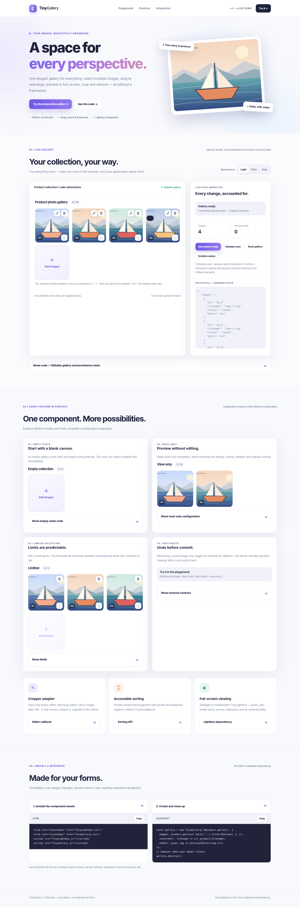
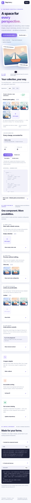
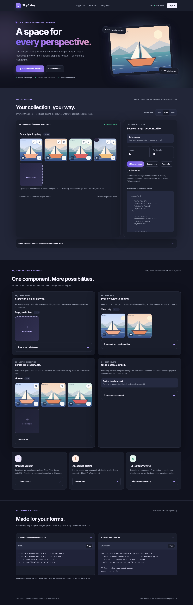

# TinyGallery

> A compact, visually polished multi-image uploader/editor UI. **Pure JavaScript**, no jQuery, with only **TinyLightbox** as a component dependency.



**Version:** 1.1 · **Runtime:** modern browser · **Required:** TinyLightbox 2.0 (sibling folder) · **Build step:** none.

## 1. Features

- Responsive collection of image thumbnails with an **Add tile always last**.
- Multiple file selection and file drop; supported staging types JPEG, PNG, WebP, GIF, AVIF, BMP.
- Mouse drag handles, touch/pen handles and arrow-key reordering **implemented internally** (no TinySortableList dependency).
- Zoom, pan, swipe, keyboard navigation and full-screen viewing via independent TinyLightbox.
- Optional async image editor/cropper callback: accepts a `File`, `Blob` or `{file|data}` descriptor.
- Soft delete, one-step Undo, staged changes, an explicit `removed` list, multiple instances.
- File count/size validation and cleanup of browser object URLs on replacement/reset/destroy.
- A safe, ordered persistence contract designed for a server-side transactional workflow.

**Not included:** database writes, HTTP uploads, server file removal, production image processing or an embedded cropper. The demo's cropper is deliberately external to TinyGallery.

## 2. Folder layout

```text
TinySuite/
├── TinyLightbox/               # independent view dependency
│   ├── TinyLightbox.js
│   └── TinyLightbox.css
└── TinyGallery/
    ├── TinyGallery.js
    ├── TinyGallery.css
    ├── TinyGallery.scss
    ├── README.md
    ├── demo/
    │   ├── index.html
    │   ├── demo.css / demo.js
    │   ├── editor.js           # sample external canvas cropper
    │   ├── lake-*.svg
    │   └── preview-*.png / viewer-*.png
    └── tests/test_gallery.py
```

Both components load without any bundler. Use the prebuilt CSS in the browser. The `.scss` source is provided for optional Sass workflows.

## 3. Minimal integration

```html
<link rel="stylesheet" href="/assets/TinyLightbox/TinyLightbox.css">
<link rel="stylesheet" href="/assets/TinyGallery/TinyGallery.css">
<div id="product-gallery"></div>
<script src="/assets/TinyLightbox/TinyLightbox.js"></script>
<script src="/assets/TinyGallery/TinyGallery.js"></script>
<script>
  const gallery = new TinyGallery('#product-gallery', {
    images: ['boat-front.webp', 'boat-side.webp'],
    resolveUrl: filename => '/products/' + encodeURIComponent(filename),
    onEdit: async image => await myCropper(image.src),
    onChange: (state, action) => console.log(action, state)
  });

  // On modal/page teardown, always call:
  gallery.destroy();
</script>
```

The `onEdit` hook can call FXBase's existing ImageUploader adapter, a canvas editor or an unrelated cropping library. Returning `null` cancels the edit. It is never a dependency of the gallery itself.

## 4. All component options

| Option | Default | Description |
|---|---|---|
| `images` | `[]` | Ordered filename array, semicolon-delimited string, or image objects |
| `resolveUrl` | Identity function | Resolve a stored filename to a browser-loadable URL |
| `maxImages` | `12` | Maximum number of entries |
| `maxFileSize` | 10 MiB | Maximum staged file size (client-side only) |
| `label` | `Photo gallery` | Gallery heading and label |
| `editable` | `true` | Show editor action if `onEdit` is supplied |
| `sortable` | `true` | Show sorting handles and allow `move()` |
| `addable` | `true` | Show the final Add tile; allow `addFiles()` |
| `removable` | `true` | Show removal action and permit `remove()` |
| `onEdit` | `null` | Async editor hook, receives image descriptor + gallery |
| `onChange` | `null` | Called after add/edit/remove/undo/reorder |
| `onError` | `null` | Client-side validation/crop error callback |
| `confirmRemove` | `null` | Optional sync/async predicate; false cancels removal |

The four UI permission switches are not security controls. The server must still authorize all writes and file deletion.

## 5. State model and persistence contract

A saved image is identified by its **canonical filename**. A new file has no filename until the backend persists it. Editing a saved image retains the original filename *only as its replacement reference* until a new canonical file is created.

```javascript
const state = gallery.getState();
// Ordered state:
// {
//   images: [
//     { id: 'tg-1', filename: 'photo-c.webp', status: 'saved',  file: null, src: '...' },
//     { id: 'tg-2', filename: 'photo-a.webp', status: 'edited', file: Blob, src: 'blob:...' },
//     { id: 'tg-3', filename: '',             status: 'added',  file: File, src: 'blob:...' }
//   ],
//   removed: ['photo-b.webp']
// }
```

| Status | Frontend meaning | Server action |
|---|---|---|
| `saved` | Image was not edited; it might have been reordered | Keep existing file, change only its position |
| `added` | New local image | Upload and assign a new server filename |
| `edited` | New bytes replace an existing image | Upload under a **new filename**, do not overwrite the old file |
| In `removed[]` | Existing image removed from final gallery | Remove the reference; physically delete only if no other references remain |

**Important:** `getValue()` returns `photo-a.webp;photo-b.webp` **only if all entries are already saved**. It throws if any new/edited image is pending. This prevents silently losing staged images. `getState()` is the appropriate source for building a multipart form payload.

### Recommended backend algorithm

1. Receive the ordered manifest and associated new/edited file parts. Authenticate and authorize the product edit.
2. Validate server-side MIME, file content, quota, original filenames, and whether old filenames actually belong to this product.
3. Lock or check the current product gallery revision to prevent concurrent overwrites.
4. Upload only `added`/`edited` bytes through the existing product image service; generate **new canonical filenames**.
5. Build the final ordered string, joining canonical names with `;`. Existing `saved` files are never rewritten.
6. Persist the new list transactionally. On database failure, clean up newly created temporary files without removing old references.
7. After the transaction commits, delete old files **only when no product or item or gallery references remain**. Retry or log cleanup failures.
8. Respond with the canonical filenames, then reset the UI using `gallery.setImages(savedNames)`.

```javascript
// Simplified client contract (HTTP transport belongs to the application):
const state = gallery.getState();
const form = new FormData();
const ordered = [];
for (const image of state.images) {
  if (image.status === 'saved') {
    ordered.push({ name: image.filename });
  } else {
    const uploadKey = `upload_${ordered.length}`;
    if (image.file) form.append(uploadKey, image.file, `${uploadKey}.png`);
    else form.append(uploadKey, image.data); // adapter-specific encoded representation
    ordered.push({ name: image.filename || null, upload: uploadKey });
  }
}
form.append('gallery_manifest', JSON.stringify(ordered));
// POST form using the application's existing authenticated backend service.
// On success: gallery.setImages(response.gallery_filenames)
```

**Never** use a naive SQL substring search to determine if an image in a semicolon list is referenced. The server must compare complete individual filenames. A client-side `removed` list is advisory, never an instruction to blindly unlink a file.

## 6. Public API

| Method | Returns | Function |
|---|---|---|
| `new TinyGallery(element, options)` | instance | Mount once on an HTMLElement |
| `TinyGallery.getInstance(element)` | instance or null | Look up the mounted gallery |
| `setImages(images)` | instance | Replace collection and clear pending modifications |
| `addFiles(files)` | number | Validate/stage selected `File` objects |
| `getItems()` | ordered descriptors | Read current order and status |
| `getState()` | `{images,removed}` | Read pending upload/delete state |
| `getValue()` | semicolon string | Read canonical filenames only when no files pending |
| `open(id)` / `close()` | boolean / void | Open/close independent TinyLightbox |
| `move(from,to)` | boolean | Reorder by numeric indices |
| `edit(id)` | Promise<boolean> | Launch external cropper adapter |
| `remove(id)` / `undo()` | Promise<boolean> / boolean | Stage deletion / undo the last deletion |
| `destroy()` | void | Destroy viewer, event listeners, thumbnails and object URLs |

The root dispatches bubbling `tinygallery:change` events with `{ action, state }`. The `onChange(state, action, gallery)` callback receives the same information. File object URLs are automatically revoked when replaced or destroyed.

## 7. Editing and cancellation

```javascript
const gallery = new TinyGallery('#images', {
  images: product.gallery?.split(';').filter(Boolean) || [],
  resolveUrl: name => productUrl(name),
  onEdit: async image => {
    // Demo includes a sample independent canvas cropper in demo/editor.js.
    // A production integration may call FXBase's existing ImageUploader.
    const blob = await myExternalEditor(image.src);
    return blob || null;
  }
});
```

When an existing image is modified, its original file remains untouched until the server accepts a replacement under a new filename. Opening the editor and cancelling makes no changes. TinyLightbox closes before an editor modal is opened, avoiding conflicting nested modals.

## 8. Sorting, drag gestures, and accessibility

- Mouse: drag the dotted handle to another tile.
- Touch/pen: drag the dotted handle (the rest of the tile remains available for preview).
- Keyboard: focus a handle and press Left, Right, Up or Down; focus returns to the moved handle.
- The `+` tile is always rendered after all image tiles and never participates in sorting.
- Zoom, swipe, pinch and image navigation are provided by TinyLightbox, not reimplemented.
- The component uses buttons, visible focus styles, live status messages, keyboard ordering and scoped styles.

## 9. Exhaustive interactive demos

Open **[`demo/index.html`](demo/index.html)**. It features a live gallery and state inspector, a real independent canvas cropper with zoom/position controls, file selection, file drop, soft deletion/Undo, mouse/keyboard sorting, sample generated upload, simulated save, read-only gallery, quota-limited gallery, empty gallery, theme switch, and collapsible code for each section.

**Offline launch:** double-click `TinyGallery/demo/index.html` after extracting the ZIP.
Keep `TinyLightbox/` beside `TinyGallery/` so its relative JavaScript and CSS references resolve.
There is no build step, HTTP server, CDN, internet connection or Base64 image
embedding. Sample files live under `demo/images/lake/` and screenshots under
`demo/images/previews/`. On browsers that restrict `canvas.toBlob()` for local
`file://` SVGs, choose that SVG from the native file picker in the cropper to
export it safely. A user-selected File receives a temporary `blob:` URL.

If the browser blocks programmatic clipboard access, the Copy button selects its snippet;
press Cmd+C (macOS) or Ctrl+C to copy it manually.

The real cropper example is in `demo/editor.js` and uses `canvas.toBlob()`; it is intentionally not part of TinyGallery. The simulated save is local only; it does not call FXBase or upload anything.





## 10. Test instructions and limitations

```bash
python3 -m pip install playwright
python3 -m playwright install chromium
python3 TinyGallery/tests/test_gallery.py
```

The automated test uses Chromium, including mobile emulation. It covers browsing, sorting, images added and edited, cancellation/removal, quotas, serialization guards, demo crop, multiple instances and cleanup. Physical iOS Safari / Android acceptance and FXBase backend integration still require separate testing.

The provided ZIP does **not** change FXBase layouts, controllers, DAOs, database schema or Online. Copy both top-level component folders into the desired `TinySuite/` directory; integrate them into product forms only after the backend gallery contract has been implemented.

### TinyLightbox v2 integration

TinyGallery delegates previews to **TinyLightbox v2**. All viewer enhancements (mouse/touch drag, zoom, animations, captions, configurable SVG icons and API) are provided by TinyLightbox. The gallery owns only the image collection and pending changes. The external editor calls `lightbox.close({animate:false})` before opening its own modal to prevent modal stacking. The `TinyGallery` core does not use an HTTP server or alter product data.
